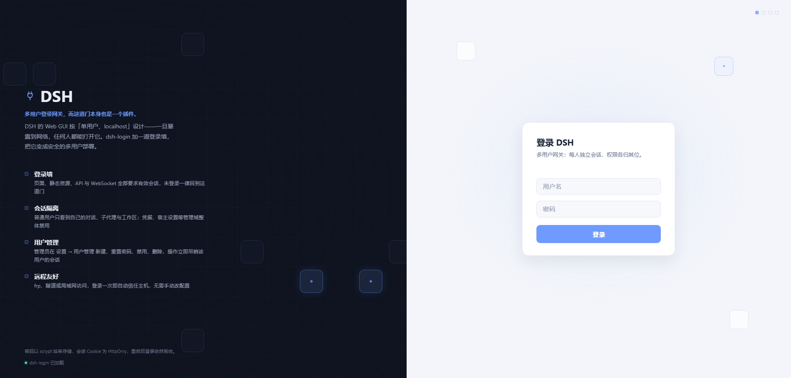
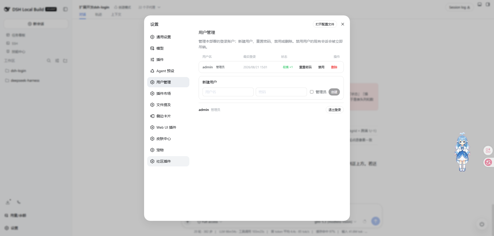

# dsh-login

English | [简体中文](./README.zh.md)

Adds a **login page, user accounts, and per-user conversation isolation** to the [DeepSeek Harness](https://github.com/deepseek-ai/deepseek-harness) Web GUI: every visit requires sign-in, ordinary users cannot see each other's conversations, and an admin manages all accounts from inside the GUI.

| Login page | User management (设置 → 用户管理) |
|:---:|:---:|
|  |  |

## The problem it solves

The DSH Web GUI ships with **no login** — it assumes a single user on localhost. The moment you bind it to `0.0.0.0` (phone access, LAN sharing, a small team), **anyone on that network can open your GUI**: read every conversation, burn your configured model API keys, even change host settings.

`dsh-login` turns that exposure into a multi-user deployment:

- 🔐 **Login wall** — pages, static assets, SPA routes, the API, and WebSockets all require a valid session; unauthenticated visitors are redirected to `/login`
- 👥 **Multiple accounts** — the first visit creates the administrator account; further users are added by an admin right inside the GUI, no CLI needed
- 🙈 **Conversation isolation** — ordinary users see and act on **their own** conversations only (including their subagents/forks); the bridge wall denies non-whitelisted methods and narrows `session.list`/`session.search`/`workspace.list` responses to owned sessions, and the dispatch-seam guard ownership-checks every dispatch (including per-user `workspace.follow` frame filtering); other users' sessions, messages, and workspaces are invisible; credentials, host settings, and other admin domains are forbidden wholesale
- 🎭 **Whole-UI role gate** — for ordinary users the gateway filters the client boot graph (`window.__DSH_BOOT__`) before serving the page, so admin-only UI plugins never mount (`uiRoleGate`, on by default)
- 🛠 **User management** — 设置 → 用户管理: last-login time, online session count, reset password, disable, remove; disabling/removing/password-changes **immediately revoke** that user's live sessions
- 👑 **Admin exception** — the admin is not isolated: all sessions visible, full configuration access
- 🚪 **Logout** — every user gets a logout entry in their settings panel
- 🌐 **Remote access friendly** — reach the GUI through frp/隧道/tunnels or a LAN IP without hand-editing `trustedHosts`: the `/api` host-trust fence uses a live set (LAN literals + `trustedHosts` + auto-learned hosts), and any successful login learns its Host into a persisted whitelist you can manage in 设置 → 用户管理

---
## Current status

**Current release: `@islibaodong/dsh-login@0.3.13`** (git tag `v0.3.13`) — tracks DSH **0.2.2-rc.2**; full suite **22 files / 298 tests** green, CI green. Per-version release notes: [GitHub Releases](https://github.com/islibaodong/dsh-login/releases).

0.3.12 is a **security release**. It fixes [issue #11](https://github.com/islibaodong/dsh-login/issues/11): streaming methods (`workspace.follow` workspace trees, and id-carrying invokes such as `session.page`) travel the `/api/remote.mux` WebSocket, which the POST-only bridge wall never saw — an ordinary user could enumerate and enter other users' workspaces. Since 0.3.12 a **dispatch-seam guard** ships in-plugin: connection admission requires a live dsh-login session on the browser path (the WebSocket upgrade included), and the gateway's dispatch seams gate every browser call per user — non-user methods denied, id arguments ownership-checked, `workspace.follow` frames filtered per frame. It also carries the merged PR #12 fix (DSH 0.2.2 homepage 400) and the CI rewrite (Node 24 matrix, dist freshness gate).

### Compatibility history

| dsh-login | DSH | Notes |
|-----------|-----|-------|
| 0.3.13 | 0.2.2-rc.2 | deps retargeted to the rc.2 tuple (wire surface 204 → 225, officeToPdf→officeKit) + 用户管理 sidebar-visibility toggle (侧边栏显示) |
| 0.3.12 | 0.2.2-rc.1 | issue #11 streaming-method isolation + PR #12 gateway fix |
| 0.3.11 | 0.2.2-rc.1 | dependency retarget onto the rc.1 line (vendor stable) |
| 0.3.10 | 0.2.2-alpha.3 | wire surface re-pinned 199 → 204 (schedule CRUD split, forge review) |
| 0.3.9 | 0.2.1-rc.5 | issue #10: the launch token never reaches remote clients |
| 0.3.8 | 0.2.2-alpha.2 | wire surface 146 → 199 (forge panel, session observation, CUA, liveshareShares) |
| 0.3.7 | 0.2.1-rc.3 | client-UI-only upstream release; zero adapter impact |
| 0.3.6 | 0.2.1-rc.2 | issue #4: allow-list re-derived from the real wire surface |

Older releases: see the [releases page](https://github.com/islibaodong/dsh-login/releases).

### Upstream multi-user watch

Upstream DSH still ships **no native user accounts** — no user store, no login, no identity UI. What DSH 0.2.1-alpha.3 added is an authorize-only RBAC engine for non-owner Peers (`packages/api/remote-access`) plus multi-principal connection machinery; it never gates owner principals, and every dsh-login user arrives as one. dsh-login remains the account/authn layer.
- **Ordinary users are conversation-only.** In option A the native `connection`/`api-gateway` owns `/api` and is agent-keyed. Three seams enforce the boundary — the first two ship in-plugin and are on by default:
  1. **Method allow-list + response narrowing on the bridge wall (`apiBridgeAuth`):** a non-admin POST whose wire endpoint is not on the `USER_ALLOWED` allow-list is denied — with `quietDenials` (default) as a wire-correct forbidden envelope, otherwise a plain 403. `session.list`/`session.search`/`workspace.list` responses are narrowed to the user's own sessions/workspaces.
  2. **Dispatch-seam guard (shipped in 0.3.12, automatic — fixes [issue #11](https://github.com/islibaodong/dsh-login/issues/11)):** connection admission requires a live dsh-login session on the browser path — including the `/api/remote.mux` WebSocket upgrade — and tags each browser peer with its dsh-login identity. The gateway's dispatch seams (`dispatchRpc`/`openWireStream`) then gate every browser call per user: non-user methods are denied, every id argument (`sessionId`/`workspaceId`/`agentId`/…) is ownership-checked against the sidecar, and `workspace.follow` streams are filtered per frame with upstream's own per-principal semantics (narrowed baselines, delivered-set accounting, replace-resync on visibility loss, fail-closed on unknown frames). Untagged peers (launch-token CLI/SDK, host-internal calls) keep upstream semantics exactly.
  3. **REMOTE-layer guard (`wrapRemoteGateway`, exported, optional):** the deployment-side composition primitive over the public gateway API ([`docs/compose-guard.md`](docs/compose-guard.md)). Since 0.3.12 the in-plugin guard already covers browser traffic, so composing this is optional belt-and-suspenders.
  Everything else is off limits:
  - physical allow-list: the user-facing wire surface (`USER_ALLOWED`, 124 of the 204 methods DSH 0.2.2-rc.1 exposes) — `session.*` (prompt/page/modelCatalog/selectModel/fork/attachment, the events/observe/state family, …), `workspace.*`, `goals.*`, `subagents.*`, `terminal.*`, `job.*`, the read-only `workspaceFiles.*`/`officeToPdf.*` document preview, the `llm.*` model-picker reads, `skills.list`, `commands.*`, `directoryPicker.*`, `schedule.*`, `speech.*`, `userQuestions.*`, `messageFeedback.*`, `sessionFeedback.record`, `fileUploads.upload`, `fileReferences.list`, `permissionPresets.catalog`, `productAnalytics.*`, `cotTranslation.*`, `sessionReferenceResolver.candidates`, the `remoteAccess.follow` grant stream, and the 0.2.2 additions (`forgePanel.*` per-session, `toolResults.watch`, `actionCards.act`, `pluginRecommendations.describe`); any other wire method is refused. The list is exhaustive against the wire surface: `tests/wire-surface.spec.ts` fails if upstream renames or adds a method without a bucket (see [`docs/adapt-dsh-0.2.1-rc.2-issue-4.md`](docs/adapt-dsh-0.2.1-rc.2-issue-4.md))
  - admin-only domains (`ADMIN_ONLY_METHODS`, 79): `credentials.*`, `settings.*`, `agentPresets.*`, the native plugin manager (`pluginManager.*`, `pluginMarket.*`, `pluginRegistryProbe.*`, `pluginInventory.*`), `dynamicCordisRunner.*`, `claudeCodeMods.*`, the whole `account.*` namespace (the single process-wide upstream DeepSeek Platform grant), CUA consent (`cuaAccess.*`), `schedule.deleteInactive`, and the `liveshareShares.*` share-management surface
  - host-internal: `workspace.initializeDefault` (first-use plumbing; denied to users and never advertised)
  - an unknown method (not on this build's wire surface) is logged once per method to the host log with the target version, so an upstream rename leaves a diagnostic instead of a silent user-facing denial — refresh `src/api-filter.ts` from the checkout with `node scripts/dump-wire-surface.mjs`
  - workspace-scoped mutations are ownership-guarded by `workspaceId`: a non-admin may only `rename`/`delete`/`insertBefore` a workspace that holds at least one of their own sessions, and `create` is confined to their own sandbox (`workspaceRoot/<username>`) — so they cannot touch other users' workspaces or register a workspace pointing at an arbitrary host directory
  - the physical `session.export` channel (target in the query string, outside the envelope) is ownership-guarded at the carrier
  - streaming: `workspace.follow` frames are filtered per user at the dispatch seam (above) — a user's workspace tree never contains another user's workspaces or sessionIds
- **Whole-UI role gate (`uiRoleGate`, on by default):** for an ordinary session the gateway filters the client boot graph (`window.__DSH_BOOT__`) before serving the index — entries in the `ADMIN_ONLY_UI_PLUGINS` deny-list never mount. Presentation-only: the `/api` allow-list stays the security boundary; admins get the unfiltered graph; unexpected shapes fail open. Granularity is per package — hiding one slot *inside* an allowed bundle is out of scope, and a plugin that self-registers exact routes (e.g. `/api/pet/pets`) is outside the bridge wall's reach. The split is binary today (admin / ordinary); extending it to arbitrary roles is evaluated in [`docs/role-based-ui-gating.md`](docs/role-based-ui-gating.md) — feasible without upstream changes, one shared role policy must feed all three seams.
- **Default user workspace (`defaultWorkspace`, on by default):** non-admin users get a per-user isolated default workspace on first `/api` access — `mkdir` their sandbox (`workspaceRoot/<username>`, default `<DSH_HOME>/workspaces/<username>`) → register it in the durable workspace registry → attach one session (`sessions.create({ workspaceId })`, the grouping shape) and record its ownership, so the workspace is immediately visible in the user's `session.list`/`workspace.follow` and ready to use. This means a non-admin never starts out workspace-less on a public/FRP deployment; since 0.3.6 the native picker (`directoryPicker.*`) also works for them, with `workspace.create` still confined to their sandbox. Admins can toggle it live from the 设置 → 用户管理 panel's 默认用户工作空间 switch (persisted to `<dataDir>/settings.json`, effective immediately, no restart); turning it off does not remove existing workspaces. Provisioning is idempotent (once per user per process) and best-effort (failures never fail the triggering request).
- **Remote access compat (`remoteWebUiCompat`, on by default):** accommodates `@linxin666/dsh-remote-web-ui` unchanged. That popular plugin's `/remote` device-pairing gate 401s non-loopback (public FRP) desktop traffic — the model dialog, history, composer — independently of dsh-login's /api auth. When this flag is on, dsh-login writes remote-web-ui's `enabled:true` (which is what actually mounts its host routes; without it the server answers nothing and the client fail-closes onto a dead `/remote` 405 wall) and `requirePairingForLan:false` (a **live, settings-backed** flag re-read per request), so non-loopback traffic rides dsh-login's `/api` channel gated by the `dsh_session` cookie instead. It also writes `publicBaseUrl` from the `remoteWebUiPublicBaseUrl` config when that is set — required for a public FRP/tunnel host so remote-web-ui's Host-header-based `/api/pair/*` fence trusts the ordinary-user origin (otherwise the browser there gets 403 on `/api/pair/status` and the client still fail-closes onto `/remote`). No-op when remote-web-ui is not installed; admins toggle it live from the 设置 → 用户管理 panel's 远程访问兼容 switch (persisted, effective immediately). Note: with `remoteWebUiCompat` defaulting to on, the pairing barrier is off for every dsh-login + remote-web-ui deployment — intended, since dsh-login's own /api auth still sits in front.
- **Capability discovery + quiet denials (`quietDenials`, on by default):** stops the browser-splashing "forbidden" walls that installed UI plugins (task-board, plugin-manager, agentPreset, doctor, …) trigger on an ordinary-user session when they probe `/api/*` they cannot use. Three layers: (1) `GET /api/auth/capabilities` returns the authenticated identity's method/domain/UI-plugin surface (ordinary = the `USER_ALLOWED` allow-list + core plugins; admin = everything), and dsh-login injects a static non-admin baseline into `window.__DSH_SESSION__` at index-render time so clients that read it render no unauthorized feature instead of probing; (2) on the `/api` bridge wall, a denied non-admin POST is answered with a **wire-correct `server-response` envelope carrying `{ ok: false, code: 'forbidden' }` (HTTP 200)** — the wall consumes the request body to echo the caller's `rpcId`, so the browser surfaces an ordinary denied-RPC error instead of a transport-failure splash; (3) with `quietDenials` off, denied POSTs fall back to a plain **403**. Authorization is never loosened — only the shape of the denial is quieter. Admins can flip `quietDenials` off to restore plain 403 everywhere.
- **`/api` bridge auth wall (`apiBridgeAuth`, on by default; DSH ≥ 0.1.6-alpha.2):** on the upstream `connection/request` hook dsh-login answers **401 for any bridged `/api` request without a live `dsh_session`** — so logout/expiry/revocation actually cut `/api` access even though the browser keeps the connection row's process-wide browser-auth cookie. Beyond authentication, the wall is the per-user enforcement seam: the method allow-list gate (above) and the response narrowing for `session.list`/`session.search`/`workspace.list` ride the same hook, and admitted `session.create`/`session.fork`/`workspace.create` responses are observed to keep the ownership sidecar warm (admin-created resources are recorded too, record-only, so the composed REMOTE-layer guard can attribute admin sessions). Plugin-exact routes (`/api/auth/*`, remote-web-ui's `/api/pair/*` pairing) never touch the bridge and keep working pre-login; since 0.3.12 the stream-mux WebSocket upgrade (`/api/remote.mux`) also passes the dispatch-seam guard's admission check, which requires a live `dsh_session` too. Turn it off only if you serve the bridge to clients that cannot carry the `dsh_session` cookie — e.g. remote-web-ui's `/remote` paired-device channel re-issues requests server-side without it (pairing is by design a full-control credential outside dsh-login's user model). On DSH < 0.1.6-alpha.2 the hook does not exist and this is a harmless no-op.
- **Admin sees and does everything:** unfiltered API access, all sessions/workspaces visible, and the 设置 → 用户管理 settings section.
- **Logout:** the settings panel's 用户管理/账户 section carries a logout entry for every user (POST `/api/auth/logout` → `/login`); `GET /logout` works as a plain link.
- **Admin user management (设置 → 用户管理):** ships inside the GUI settings panel via the browser bundle — no separate page. Inside it, the **Allowed Hosts / Trusted Hosts** card lists the `/api` whitelist (learned + manually added) with add/remove — removing takes effect immediately. A **默认用户工作空间** switch toggles the per-user default-workspace provisioning live (persisted, no restart), a **远程访问兼容** switch toggles the remote-web-ui `requirePairingForLan` bypass, and a **侧边栏显示** switch toggles whether the 用户管理 entry itself appears in the settings sidebar (persisted, effective immediately — no reload needed). The user list reports each account's last-login time (stamped on every successful login; `never` before its first login after the feature shipped), online session count, and disabled flag; per-row actions reset passwords, disable/enable, and remove users (single non-wrapping line, right-aligned). Ordinary users get an 账户 section (identity + logout). The panel styles itself entirely through the framework's `--dsw-alias-*` theme tokens, so it follows the app skin (light/dark) automatically.
- **Sidebar visibility toggle (侧边栏显示, on by default):** a global admin switch that hides the 用户管理 section from the settings sidebar without touching any account. The section (de)registers live as the flag flips, so the sidebar follows without a reload; while the admin is viewing the panel it stays open and only disappears once they navigate away. When hidden, admins fall back to the 账户 section — which carries the same 侧边栏显示 switch — so the setting can always be turned back on and logout is never out of reach. Ordinary users are unaffected.

## Data locations

| Data | Location |
|------|----------|
| User accounts (scrypt hashes) | DSH credentials system, ref `${password}_USERS` (default `DSH_LOGIN_PASSWORD_USERS`) |
| Session→user ownership sidecar | `<DSH_HOME>/.dsh-login/ownership.json` (configurable via `dataDir`; `DSH_HOME` env or `~/.dsh`) |
| Auto-learned / admin Host whitelist | `<DSH_HOME>/.dsh-login/trusted-hosts.json` (configurable via `dataDir`) |
| Default-user-workspace toggle | `<DSH_HOME>/.dsh-login/settings.json` (configurable via `dataDir`) |
| Remote-web-ui compat toggle | `<DSH_HOME>/.dsh-login/settings-remote-web-ui.json` (configurable via `dataDir`) |
| Sidebar visibility toggle (侧边栏显示) | `<DSH_HOME>/.dsh-login/settings-sidebar.json` (configurable via `dataDir`) |
| Login sessions | `<DSH_HOME>/.dsh-login/sessions.json` (0o600; persisted across restarts, TTL drops stale) |

## `/api` integration (option A, DSH ≥ 0.1.5-alpha.1)

For DSH ≥ 0.1.5-alpha.1 dsh-login **no longer takes over the `/api` carrier**: `cordis.patch.yml`
leaves the shipped `connection` row enabled, so `dsh-client-connection` + `api-remotes` /
`api-gateway` own the `/api` transport and the live Remote streams. dsh-login composes its
per-user layer on top of that native stack (see [`docs/adapt-dsh-0.1.5.md`](docs/adapt-dsh-0.1.5.md)
and the verification checklist [`docs/verify-option-A.md`](docs/verify-option-A.md)):
fallback login wall + static serving through the native `serveStatic`, plus
`connection.authorizeIndex` on index responses so the browser receives its upstream `/api`
cookie. The old `src/connection.ts` carrier takeover and its `dist/client.js` re-stamp were
removed with the `dsh-host-apiproxy`-based per-user `ApiProxy`. Since 0.3.12 the per-user
conversation/workspace isolation is enforced automatically by the in-plugin **dispatch-seam
guard** (admission tagging + per-user dispatch gating + `workspace.follow` frame filtering) —
no deployment-side composition is required. The REMOTE-layer guard (`wrapRemoteGateway` +
`createRemoteIsolation`, with the `composeDshLoginGuard` glue that publishes the ownership
sidecar as `dshLoginOwnership`) remains exported as an optional deployment-side composition;
see [`docs/compose-guard.md`](docs/compose-guard.md).

**Host trust is evaluated live per request.** The `/api` fence uses a deduped effective set —
LAN literals from the web runtime + `trustedHosts` + the persisted whitelist (`src/hosts.ts`).
A successful login/setup auto-learns the request Host (gated by `autoTrustHosts`, default
true), so a public host reached through frp/隧道/tunnels is trusted after one login; learned
hosts bind immediately and removals apply without a restart.

## Security notes

### Protected by the gateway

| Asset | Protection |
|-------|-----------|
| Page navigation (`/`) | 302 redirect to `/login` if unauthenticated |
| Static assets (`/assets/*.js`, `.css`, etc.) | Same gateway check |
| SPA routes (`/conversations`, `/settings`, etc.) | Same gateway check |

**The process launch token never reaches remote clients (issue #10).** The
core mints one random launch token per process; `dsh web` prints the
`/?token=…` URL in the **local console only**, and that token is what mints
the browser cookie and what `GET /connect` exchanges for an owner-principal
API credential. Earlier releases bootstrapped a fresh device by bouncing the
browser to `/?token=<launchToken>`, which exposed the token to the remote
client (Location header → browser history, proxy access logs) — dsh-login
0.3.9 instead runs the same exchange server-side and serves the index
directly with the minted cookie, so the token never appears on the wire. A
remote user can therefore never reach owner credentials through dsh-login;
the token remains a local-console-only secret, exactly as upstream delivers
it.

### Protected by the bridge wall

| Asset | Protection |
|-------|-----------|
| API requests (`/api/*`) | `isTrustedApiRequest` host trust **and** a valid `dsh_session` cookie (401 without one); non-allowed POST methods denied for ordinary users (wire-correct forbidden envelope with `quietDenials`, else 403); `session.list`/`session.search`/`workspace.list` responses narrowed to owned sessions |
| WebSocket (`/api/remote.mux`) | Host-trust + browser-auth checks on upgrade (upstream fence); since 0.3.12 the dispatch-seam guard also requires a live `dsh_session` on the upgrade and filters `workspace.follow` frames per user |

### Recommendations for public exposure

1. With `autoTrustHosts` on (default), any successful login learns its Host into the whitelist (`/api/auth/admin/hosts`, manageable in 设置 → 用户管理), so an frp/tunnel host is trusted after one login — no `trustedHosts` editing needed. Keep it on unless you want only loopback + an explicit `trustedHosts` set to be accepted.
2. Use a reverse proxy (nginx/caddy) with TLS termination in front of DSH.
3. The gateway cookie is `SameSite=Strict`, protecting against CSRF on the login/logout endpoints.

**Troubleshooting: a non-admin user "cannot add a workspace" over a public tunnel?**

This is almost never the host whitelist (`autoTrustHosts` already learns the public host and login succeeds). Since 0.3.6 the native directory picker (`directoryPicker.*`) is admitted to ordinary users and `workspace.create` is confined to the caller's sandbox (`workspaceRoot/<username>`), so the native add-workspace flow works; `defaultWorkspace` (on by default) also pre-provisions an isolated sandbox on first `/api` access. If `/api` still answers `not permitted for this user` on a current build, the method is off this build's wire surface: check the host log for the one-per-method `dsh-login: /api/<method> was denied …` line (it names the DSH version the allow-list targets) and re-sync with `node scripts/dump-wire-surface.mjs`.

## Architecture note: fallback vs prefix /

The gateway uses `registerFallback()` (not `register({ kind: 'prefix', path: '/' })`) because the DSH WebServer's prefix matching checks `pathname.startsWith(prefix + '/')`. For prefix `/`, this becomes `//`, which no normal path starts with -- a `prefix /` route only matches the exact path `/`. The fallback handler catches everything no named route claims, which is the correct catch-all behavior for the authentication gateway.

The WebServer has a single fallback seat. dsh-web-app's `web-runtime` row mounts frontend-static over it unconditionally, so the `web-runtime` row must be disabled when using `dsh-login`; dsh-login re-provides the `webRuntime` service that row owned (LAN trust, `DSH_WEB_URL`), leaving the rest of the composition intact.

## Running tests

```bash
# Use Node >=24.9.0 with DSH 0.2.2-rc.1.
# Install the released DSH dependencies pinned in the lockfile; no checkout required.
npm ci
npm test
npm run verify:imports
npm run build
```

The `.spec.ts` files are the canonical vitest definitions, including the pure/multi-user-adjacent suites (`users`, `ownership`, `hosts`, `admin-api`, `session`, `gateway`, `capabilities`, `remote-web-ui-compat`, `client-bundle`, `settings-panel`, `plugin-entry`, `bridge-list-filter`, …). The `connection` / `api-filter` / `multiuser-e2e` specs were **removed** in the option-A adaptation (they tested the deleted `dsh-host-apiproxy` `/api` takeover); the dispatch-seam guard (admission tagging, per-user dispatch gating, `workspace.follow` frame filtering) is covered by `tests/dispatch-guard.spec.ts`, the REMOTE-layer isolation guard by `tests/remote-guard.spec.ts` (ownership scoping, admin passthrough, array/nested id-arg ownership), and the bridge wall (401 + method gate + quiet denials + record/filter tee + provisioning trigger) by `tests/api-bridge-auth.spec.ts`. CI runs the full suite on Node 24.9.0 and the latest Node 24.x, plus the legacy unit smoke tests, source-import checks, builds, and a committed-bundle freshness check. `node --import tsx/esm tests/runner.mjs` remains a lightweight unit smoke test. `node tests/integration-runner.mjs` runs the canonical gateway, multi-user login/setup/logout, and full-plugin HTTP integration specs.

## Project structure

```
src/
├── index.ts          # Cordis plugin entry: registers auth routes, fallback login gateway, webRuntime
├── config.ts         # schemastery config schema (password, distIndex, dataDir, sessionTtl, ...)
├── users.ts          # UserStore: user records, scrypt hashing, credentials-backed persistence
├── session.ts        # SessionStore: sessions (user + admin flag) with TTL expiry, persisted across restarts
├── ownership.ts      # OwnershipIndex: sessionId → username sidecar (debounced JSON file)
├── hosts.ts          # TrustedHosts: trusted-host whitelist (live set + debounced JSON persistence)
├── api-filter.ts     # pure predicates (AuthUser/USER_ALLOWED/isUserAllowed) for the per-user admission seam
├── bridge-list-filter.ts  # wire-response observation: owned-session closure + session/workspace.list narrowing (used by the bridge wall)
├── host-session-access.ts  # lazy host-side session surface (sessionController first, typertGateway fallback) for provisioning/list-probe
├── provision.ts      # DefaultWorkspaceProvisioner: per-user sandbox + registry workspace + seeded attached session
├── glue.ts           # deployment-side composition glue (dshLoginOwnership service + composeDshLoginGuard), see docs/compose-guard.md
├── settings-panel.client.js  # settings-panel browser half (plain JS): 用户管理/账户 section, theme-token styled
├── workspace-setting.ts  # 默认用户工作空间 runtime toggle (extends BooleanSetting)
├── boolean-setting.ts  # live + persisted {enabled} runtime flag shared by admin switches
├── remote-web-ui-compat.ts  # writes remote-web-ui's enabled+requirePairingForLan+publicBaseUrl (settings-backed, live) to mount its routes & bypass pairing / trust the public host
├── capabilities.ts  # capability discovery (deriveCapabilities) + read-probe classifier (isReadProbe/QUIET_DENY_METHODS)
├── admin-api.ts      # /api/auth/me + /api/auth/capabilities + /api/auth/admin/* JSON routes (settings-panel backend)
├── auth.ts           # Cookie management + constant-time compare helpers
├── gateway.ts        # Auth gateway fallback (login wall + serveStatic + upstream connection.authorizeIndex)
├── login-api.ts      # POST /api/auth/login + logout + setup
├── login-page.ts     # Login and setup page HTML
├── http-json.ts      # readBody/sendJson helpers + resolveDshHome
├── remote-guard.ts   # REMOTE-layer per-user isolation guard (wrapRemoteGateway + createRemoteIsolation), exported from the host bundle
├── api-bridge-auth.ts  # shared /api bridge wall: 401 + method gate + quiet denials + response tee
├── dispatch-guard.ts   # dispatch-seam guard: admission tagging + per-user dispatch gating + workspace.follow frame filtering (issue #11)
└── web-runtime.ts    # webRuntime takeover: LAN trust + DSH_WEB_URL
tests/ (22 files / 298 tests green)
└── *.spec.ts         # vitest test definitions
```

## License

MIT
