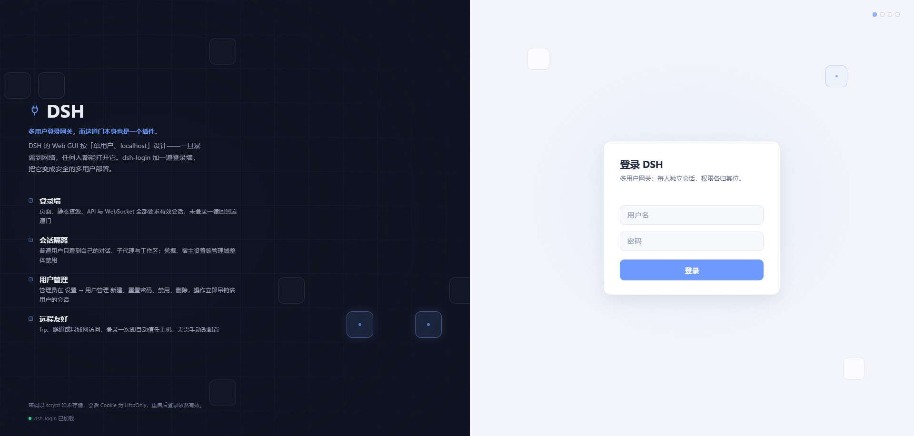
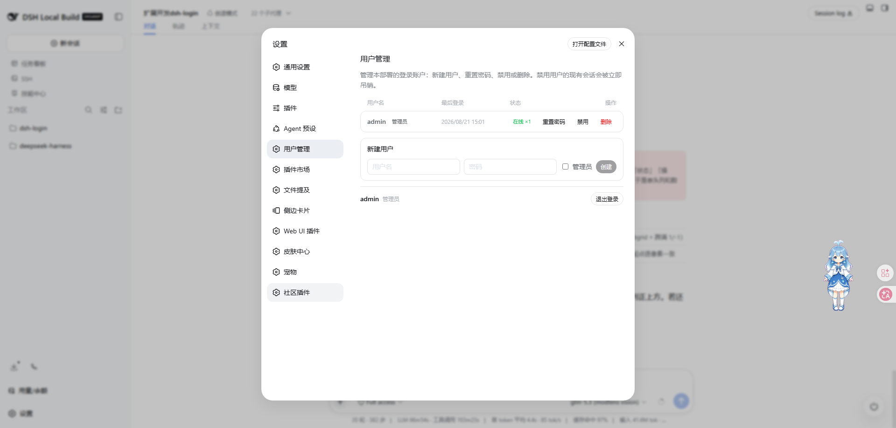

# dsh-login

[English](./README.md) | 简体中文

给 [DeepSeek Harness](https://github.com/deepseek-ai/deepseek-harness) Web GUI 加上**登录页、用户账号和会话隔离**的插件：访问先登录，普通用户互相看不见对话，管理员在 GUI 内管理所有账号。

| 登录页 | 用户管理（设置 → 用户管理） |
|:---:|:---:|
|  |  |

## 这个插件解决什么问题

DSH 的 Web GUI 本身**没有登录**——它按“单用户、localhost”设计。只要把服务绑到 `0.0.0.0`（手机访问、局域网共享、团队共用），**网络上任何人都能直接打开你的 GUI**：看到全部对话、用你配置的模型密钥消耗额度，甚至修改宿主配置。

`dsh-login` 把它变成一个多用户部署：

- 🔐 **登录墙** —— 页面、静态资源、SPA 路由、API、WebSocket 全部要求有效会话，未登录一律跳转 `/login`
- 👥 **多账号** —— 首次访问创建管理员账号，其余用户由管理员在 GUI 里直接新建，无需命令行
- 🙈 **会话隔离** —— 普通用户只能看到、操作**自己**的对话（含其派生的子代理/分叉）；桥墙对普通用户拒绝白名单外的方法，并把 `session.list`/`session.search`/`workspace.list` 响应收窄为自己拥有的会话；dispatch-seam 守卫对每次分发做归属校验（含 `workspace.follow` 流的逐用户帧过滤）；其他人的会话、消息、工作区一律不可见；凭据、宿主设置等管理域整体禁用
- 🎭 **整 UI 角色门** —— 普通用户的页面在返回前会过滤客户端引导图（`window.__DSH_BOOT__`），admin 专属 UI 插件不再挂载（`uiRoleGate`，默认开）
- 🛠 **用户管理** —— 设置 → 用户管理：最后登录时间、在线会话数、重置密码、禁用、删除；禁用/删除/改密会**立即吊销**该用户的现有会话
- 👑 **管理员例外** —— 管理员不受隔离限制，可见全部会话，可配置宿主
- 🚪 **登出** —— 每个用户的设置面板里都有登出入口
- 🌐 **远程访问友好** —— 通过 frp/隧道或局域网 IP 访问 GUI 无需手改 `trustedHosts`：`/api` 主机信任围栏使用「实时有效集」（LAN 字面量 + `trustedHosts` + 已学习主机），且任何成功登录都会把请求 Host 学进持久化白名单，可在「设置 → 用户管理」里增删管理

---
## 当前状态

**当前版本：`@islibaodong/dsh-login@0.3.13`**（git 标签 `v0.3.13`）——跟随 DSH **0.2.2-rc.2**；全量测试 **22 文件 / 298 用例**全绿，CI 绿。各版本详细说明见 [GitHub Releases](https://github.com/islibaodong/dsh-login/releases)。

0.3.12 是**安全修复版本**，修复 [issue #11](https://github.com/islibaodong/dsh-login/issues/11)：流式方法（`workspace.follow` 工作区树、以及带 id 的 `session.page` 等调用）走 `/api/remote.mux` WebSocket，只拦 POST 的桥墙完全看不见——普通用户可枚举并切入他人的工作区。0.3.12 起插件内置 **dispatch-seam guard**：连接准入要求浏览器路径携带有效 dsh-login 会话（含 WebSocket upgrade），分发 seam 对每次浏览器调用逐用户把关——非 user 方法拒绝、id 参数过归属校验、`workspace.follow` 逐帧过滤。同时带上已合并的 PR #12 修复（DSH 0.2.2 登录后主页 400）与 CI 重写（Node 24 矩阵、dist 新鲜度闸门）。

### 兼容历史

| dsh-login | DSH | 说明 |
|-----------|-----|------|
| 0.3.13 | 0.2.2-rc.2 | 依赖重定向到 rc.2 元组线（线面 204 → 225，officeToPdf→officeKit）+ 用户管理「侧边栏显示」开关 |
| 0.3.12 | 0.2.2-rc.1 | issue #11 流式方法隔离修复 + PR #12 网关修复 |
| 0.3.11 | 0.2.2-rc.1 | 依赖重定向到 rc.1 元组线（vendor 稳定版） |
| 0.3.10 | 0.2.2-alpha.3 | 线面重钉 199 → 204（schedule CRUD 拆分、forge 评审面） |
| 0.3.9 | 0.2.1-rc.5 | issue #10：launch token 不再暴露给远程客户端 |
| 0.3.8 | 0.2.2-alpha.2 | 线面 146 → 199（forge 面板、会话观察、CUA、liveshareShares） |
| 0.3.7 | 0.2.1-rc.3 | 上游纯客户端 UI 版本，适配面零影响 |
| 0.3.6 | 0.2.1-rc.2 | issue #4：按真实线面重推放行清单 |

更早版本见 [Releases 页面](https://github.com/islibaodong/dsh-login/releases)。

### 上游多用户观察

上游 DSH 仍**没有原生用户账号**——没有用户存储、没有登录、没有身份 UI。0.2.1-alpha.3 引入的是面向非 owner Peer 的只授权 RBAC 引擎（`packages/api/remote-access`）与多主体连接机制；它不拦 owner 主体，而 dsh-login 用户全部以 owner 主体抵达。dsh-login 仍是账号/认证层。
- **普通用户只能使用会话功能。** 在 option A 下 `/api` 由原生 `connection`/`api-gateway` 持有并按 agent 键控；按用户隔离由三道 seam 组成——前两道随插件内置、默认生效：
  1. **桥墙方法门 + 响应收窄（`apiBridgeAuth`）**——普通用户的 POST 分发只放行 `USER_ALLOWED` 白名单方法，白名单外直接拒绝（`quietDenials` 默认开时回 wire 正确的 forbidden envelope，否则 403）；`session.list`/`session.search`/`workspace.list` 响应收窄为仅含自己拥有的会话/工作区；
  2. **dispatch-seam 守卫（0.3.12 起内置，自动生效——修复 [issue #11](https://github.com/islibaodong/dsh-login/issues/11)）**——连接准入要求浏览器路径携带有效 dsh-login 会话（含 `/api/remote.mux` WebSocket upgrade），并把 dsh-login 身份打标到每个浏览器 peer；分发 seam（`dispatchRpc`/`openWireStream`）随后对每次浏览器调用逐用户把关：非 user 方法拒绝、全部 id 参数（`sessionId`/`workspaceId`/`agentId`/…）过归属校验、`workspace.follow` 流逐帧过滤（镜像上游 per-principal 语义：baseline 收窄、delivered 集合记账、可见性丢失 replace 重同步、未知帧 fail-closed）。未打标 peer（launch-token CLI/SDK、宿主内部调用）保持上游原语义。
  3. **REMOTE 层守卫（`wrapRemoteGateway`，导出、可选）**——面向部署方的组合原语，包装网关公开 API（见 [`docs/compose-guard.md`](docs/compose-guard.md)）；0.3.12 起内置守卫已覆盖浏览器流量，组合它属于额外的纵深防御。
  其余一律禁止：
  - 物理层允许清单：面向用户的线方法面（`USER_ALLOWED`，DSH 0.2.2-rc.1 实际暴露的 204 个方法中的 124 个）——`session.*`（prompt/page/modelCatalog/selectModel/fork/attachment、events/observe/state 族等）、`workspace.*`、`goals.*`、`subagents.*`、`terminal.*`、`job.*`、只读 `workspaceFiles.*`/`officeToPdf.*` 文档预览、`llm.*` 模型选择读取、`skills.list`、`commands.*`、`directoryPicker.*`、`schedule.*`、`speech.*`、`userQuestions.*`、`messageFeedback.*`、`sessionFeedback.record`、`fileUploads.upload`、`fileReferences.list`、`permissionPresets.catalog`、`productAnalytics.*`、`cotTranslation.*`、`sessionReferenceResolver.candidates`、`remoteAccess.follow` 授权流，以及 0.2.2 新增面（按会话的 `forgePanel.*`、`toolResults.watch`、`actionCards.act`、`pluginRecommendations.describe`）；其他任何线上方法都会被拒绝。清单对 wire 面是穷尽的：上游改名或新增方法而没分类时，`tests/wire-surface.spec.ts` 会失败（见 [`docs/adapt-dsh-0.2.1-rc.2-issue-4.md`](docs/adapt-dsh-0.2.1-rc.2-issue-4.md)）
  - 管理员专属域（`ADMIN_ONLY_METHODS`，79 个）：`credentials.*`、`settings.*`、`agentPresets.*`、原生插件管理器（`pluginManager.*`、`pluginMarket.*`、`pluginRegistryProbe.*`、`pluginInventory.*`）、`dynamicCordisRunner.*`、`claudeCodeMods.*`、整个 `account.*` 命名空间（唯一的进程级上游 DeepSeek Platform 授权）、CUA 同意（`cuaAccess.*`）、`schedule.deleteInactive` 与 `liveshareShares.*` 分享管理面
  - 宿主内部：`workspace.initializeDefault`（首次使用的内部管线，对用户拒绝且从不对外通告）
  - 未知方法（不在本版本 wire 面上）会在宿主日志里按方法名报一次并带上目标版本，于是上游改名留下的是诊断信息而不是用户侧的静默拒绝——用 `node scripts/dump-wire-surface.mjs` 从 checkout 重新生成 `src/api-filter.ts`
  - 工作区级变更按 `workspaceId` 所有权守卫：普通用户只能对「含自己会话」的工作区执行 `rename`/`delete`/`insertBefore`，`create` 只能落在自己的沙箱目录（`workspaceRoot/<username>`）内——既动不了他人的工作区，也不能把工作区指向任意宿主目录
  - 物理层 `session.export` 通道（目标在查询字符串中、不走信封）在通道层按所有权校验
  - 流式：`workspace.follow` 帧在 dispatch seam 逐用户过滤（见上）——用户看到的工作区树永不包含他人的工作区或 sessionId
- **整 UI 角色门（`uiRoleGate`，默认开）：** 普通会话的页面在返回前会过滤客户端引导图（`window.__DSH_BOOT__`）——命中 `ADMIN_ONLY_UI_PLUGINS` 拒绝清单的条目不再挂载。仅是展示层：安全边界仍是 `/api` 放行面；管理员拿到完整图；意外形状 fail-open。粒度只到包——隐藏放行包内部的某个 slot 不在范围内；自行注册精确路由（如 `/api/pet/pets`）的插件也不在桥墙可拦截范围内。当前只有 admin / 普通用户两档；扩展为任意角色的可行性评估见 [`docs/role-based-ui-gating.md`](docs/role-based-ui-gating.md)——无需上游改动即可实现，但必须由同一份角色策略同时驱动三条拦截缝。
- **默认用户工作空间（`defaultWorkspace`，默认开启）：** 非管理员首次经 `/api` 访问时，自动为其供给一个按用户名隔离的默认工作区——`mkdir` 其沙箱目录（`workspaceRoot/<username>`，默认 `<DSH_HOME>/workspaces/<username>`）→ 注册进 durable workspace registry → 附加一个会话（`sessions.create({ workspaceId })`，群组归属）并记入所有权索引，使工作区立即在 `session.list`/`workspace.follow` 对用户可见、可直接开聊。这让非管理员在公网/FRP 部署下不会一开始就没有工作区可用；自 0.3.6 起原生目录选择器（`directoryPicker.*`）对他也放行，而 `workspace.create` 仍被限制在其沙箱内。管理员可在「设置 → 用户管理」通过「默认用户工作空间」开关实时开/关（持久化于 `<dataDir>/settings.json`，即时生效，无需重启）；关闭不影响已存在的工作区。供给幂等（每用户每进程一次）、best-effort（失败不阻断请求）。
- **远程访问兼容（`remoteWebUiCompat`，默认开启）：** 不改动社区常用插件 `@linxin666/dsh-remote-web-ui`。该插件的 `/remote` 设备配对门槛会在非回环（公网 frp）访问时，对桌面端（模型对话框、历史、写作区）返回 401——这与 dsh-login 本身正常的 `/api` 鉴权无关。开启本项时，dsh-login 会把 remote-web-ui 的 `enabled` 写为 `true`（这正是让它挂载宿主路由 `/remote`、`/api/pair/*` 的关键；否则服务端什么都不响应，客户端会回落到死掉的 `/remote` 405 墙）并把 `requirePairingForLan` 写为 `false`（**实时、settings 驱动**、每次请求重读），使非回环访问走 dsh-login 用 `dsh_session` cookie 鉴权的 `/api` 通道；同时若配置了 `remoteWebUiPublicBaseUrl`，会一并写入 `publicBaseUrl`——公网 frp/隧道场景必须设置，否则 remote-web-ui 基于 Host 头的 `/api/pair/*` 围栏会拒绝公网来源（浏览器在 `/api/pair/status` 得到 403，客户端仍回落 `/remote`）。未安装 remote-web-ui 时本项无效果；管理员可在「设置 → 用户管理」的「远程访问兼容」开关实时开/关（持久化、即时生效）。注意：`remoteWebUiCompat` 默认开启意味着所有「dsh-login + remote-web-ui」部署的配对门槛都默认关闭——这是预期的，因为 dsh-login 自己的 `/api` 鉴权仍在其前面。
- **`/api` 桥鉴权墙（`apiBridgeAuth`，默认开启；DSH ≥ 0.1.6-alpha.2）：** 在上游的 `connection/request` 钩子上，dsh-login 对**未携带有效 `dsh_session` 的桥接 `/api` 请求直接回 401**——注销/过期/吊销会话后，即使浏览器仍持有 connection 行的进程级浏览器 cookie，也无法继续调用 `/api`。对已认证的普通用户，桥墙继续做方法级强制（见上文两层模型）并在请求/响应两侧保温所有权索引：记录经 `session.create`/`session.fork`/`workspace.create` 产生的新资源（含管理员创建——record-only，不限制管理员请求），过滤普通用户的 list 响应，并在需要时触发默认工作区供给。插件自有精确路由（`/api/auth/*`、remote-web-ui 的 `/api/pair/*` 配对）不经过桥，登录前照常可用；Remote 流 mux 的 WebSocket 升级仍由上游的 Host/Origin + 浏览器鉴权围栏把关（上游没有提供逐请求钩子）。仅当有无法携带 `dsh_session` cookie 的客户端需要直连桥时才关闭本项——例如 remote-web-ui 的 `/remote` 配对设备通道会在服务端重新发起请求且不带该 cookie（配对凭证在设计上就是绕开 dsh-login 用户模型的完全控制凭据）。DSH < 0.1.6-alpha.2 时该钩子不存在，本项是无害的空操作。
- **管理员可见可做一切：** 不受限的 API 访问、所有会话/工作区可见，以及「设置 → 用户管理」设置分区。
- **登出：** 设置面板的「用户管理/账户」分区为每个用户提供登出入口（POST `/api/auth/logout` → `/login`）；`GET /logout` 可作为普通链接使用。
- **管理员用户管理（设置 → 用户管理）：** 通过浏览器 bundle 内置在 GUI 设置面板中，无独立页面。其中有一张「访问白名单 / Trusted Hosts」卡片列出 `/api` 白名单（自动学习 + 手动添加），支持增删；删除立即生效。「默认用户工作空间」开关实时开/关默认工作区供给（持久化、无需重启），「远程访问兼容」开关实时开/关 remote-web-ui 配对绕过，「侧边栏显示」开关实时显示/隐藏设置侧边栏里的「用户管理」入口本身（持久化、即时生效、无需刷新）。用户列表显示每个账号的最后登录时间（每次成功登录时落盘；功能上线后从未登录过的账号显示「从未登录」）、在线会话数与禁用标记；每行提供重置密码、禁用/启用、删除操作（单行右对齐不换行）。普通用户则得到「账户」分区（身份信息 + 登出入口）。面板样式全部走框架的 `--dsw-alias-*` 主题令牌，自动跟随应用皮肤（浅色/深色）。
- **侧边栏显示开关（侧边栏显示，默认开启）：** 面向管理员的全局开关，可以在不动任何账号的情况下把「用户管理」分区从设置侧边栏隐藏。开关切换时分区实时注册/注销，侧边栏即时跟随、无需刷新；管理员正停留在面板上时面板保持打开，离开后入口才消失。隐藏期间管理员回退到「账户」分区——其中带有同一个「侧边栏显示」开关——随时可以重新开启，登出也始终可达。普通用户不受影响。

## 数据位置

| 数据 | 位置 |
|------|------|
| 用户账号（scrypt 哈希） | DSH 凭据系统，引用 `${password}_USERS`（默认 `DSH_LOGIN_PASSWORD_USERS`） |
| 会话→用户所有权索引 | `<DSH_HOME>/.dsh-login/ownership.json`（可用 `dataDir` 配置；`DSH_HOME` 环境变量或 `~/.dsh`） |
| 自动学习 / 管理员白名单 | `<DSH_HOME>/.dsh-login/trusted-hosts.json`（可用 `dataDir` 配置） |
| 默认用户工作空间开关 | `<DSH_HOME>/.dsh-login/settings.json`（可用 `dataDir` 配置） |
| 远程访问兼容开关 | `<DSH_HOME>/.dsh-login/settings-remote-web-ui.json`（可用 `dataDir` 配置） |
| 侧边栏显示开关 | `<DSH_HOME>/.dsh-login/settings-sidebar.json`（可用 `dataDir` 配置） |
| 登录会话 | `<DSH_HOME>/.dsh-login/sessions.json`（0o600；跨重启存续，TTL 过期的自动剔除） |

## `/api` 集成（option A，DSH ≥ 0.1.5-alpha.1）

DSH ≥ 0.1.5-alpha.1 下 dsh-login **不再接管 `/api` 通道**：`cordis.patch.yml` 让自带的 `connection` 行保持启用，`dsh-client-connection` + `api-remotes`/`api-gateway` 持有 `/api` 传输与实时 Remote 流。dsh-login 在这些原生栈之上组成自己的按用户层（详见 [`docs/adapt-dsh-0.1.5.md`](docs/adapt-dsh-0.1.5.md) 与验收清单 [`docs/verify-option-A.md`](docs/verify-option-A.md)）：登录墙占据 fallback 席位并通过原生 `serveStatic` 提供静态服务，同时在对 index 响应时调用 `connection.authorizeIndex`，让浏览器拿到上游 `/api` cookie。旧的 `src/connection.ts` 通道接管及其基于 `dsh-host-apiproxy` 的按用户 `ApiProxy` 已被移除。0.3.12 起按用户会话/工作区隔离由插件内置的 **dispatch-seam 守卫**自动执行（准入打标 + 逐用户分发把关 + `workspace.follow` 逐帧过滤），无需部署侧组合。REMOTE 层守卫（`wrapRemoteGateway` + `createRemoteIsolation`，及发布 `dshLoginOwnership` 服务的 `composeDshLoginGuard` 胶水）仍从宿主 bundle 导出，作为可选的部署侧组合；见 [`docs/compose-guard.md`](docs/compose-guard.md)。

**主机信任按请求实时求值。** 围栏不再用静态列表，而是一组去重后的「有效集」——web runtime 的 LAN 字面量 + `trustedHosts` + 持久化白名单（`src/hosts.ts`）。每次成功登录/setup 都会自动学习请求 Host（受 `autoTrustHosts` 控制，默认开启），因此经 frp/隧道访问的公网主机**登录一次即被信任**；已学习的主机立即生效、删除后无需重启即失效。

客户端侧，本包自带一个独立的 `dsh.client`（`dist/client.js`，由 `scripts/build-client.mjs` 生成）：一个 `__ModuleLoader__.load({ id:"@islibaodong/dsh-login", factory })` 注册，应用 `src/settings-panel.client.js` 并注册「设置 → 用户管理/账户」分区（样式走框架 `--dsw-alias-*` 主题令牌；`dsh.client.inject` 列举 `@deepseek-ai/dsh-client-ui-settings`、`@deepseek-ai/dsh-client-locale`）。不再重打上游 connection 客户端。重新生成：

```bash
npm run build:client   # node scripts/build-client.mjs
```

## 安全说明

### 网关保护范围

| 资产 | 保护方式 |
|------|----------|
| 页面导航 (`/`) | 未认证时 302 重定向到 `/login` |
| 静态资源 (`/assets/*.js`、`.css` 等) | 同样的网关检查 |
| SPA 路由 (`/conversations`、`/settings` 等) | 同样的网关检查 |

**进程 launch token 绝不会到达远程客户端（issue #10）。** 核心为每个进程铸造一个随机 launch token；`dsh web` 只把 `/?token=…` URL 打印在**本地控制台**，该令牌既用于铸造浏览器 Cookie，也是 `GET /connect` 兑换 owner 主体 API 凭据的凭据。早期版本通过把浏览器 302 到 `/?token=<launchToken>` 来引导新设备，这会把令牌暴露给远程客户端（Location 头 → 浏览器历史、代理访问日志）——dsh-login 0.3.9 改为在服务端完成同样的交换，直接带着铸造好的 Cookie 返回 index，令牌从此不出现在线路上。因此远程用户无法再经由 dsh-login 触达 owner 凭据；令牌保持为仅本地控制台可知的秘密，与上游的交付方式一致。

### 桥墙保护范围

| 资产 | 保护方式 |
|------|----------|
| API 请求 (`/api/*`) | `isTrustedApiRequest` 主机信任检查 **加上** 有效 `dsh_session` Cookie（缺失则 401）；普通用户白名单外 POST 方法被拒（`quietDenials` 时回 wire 正确的 forbidden envelope，否则 403）；`session.list`/`session.search`/`workspace.list` 响应收窄为拥有的会话 |
| WebSocket (`/api/remote.mux`) | 升级时主机信任 + 浏览器鉴权检查（上游围栏）；0.3.12 起 dispatch-seam 守卫同样在升级时要求有效 `dsh_session`，并对 `workspace.follow` 帧逐用户过滤 |

### 公网暴露建议

1. 开启 `autoTrustHosts`（默认）时，任何成功登录都会把请求 Host 学进白名单（`/api/auth/admin/hosts`，可在「设置 → 用户管理」管理），于是 frp/隧道主机登录一次即被信任，无需手改 `trustedHosts`。如需只接受回环 + 显式 `trustedHosts`，把它设为 `false`
2. 在 DSH 前部署反向代理（nginx/caddy）进行 TLS 终结
3. 网关 Cookie 为 `SameSite=Strict`，可防止针对登录/登出端点的 CSRF 攻击

**排障：公网普通用户"无法添加工作区"？**

几乎从不是 Host 白名单问题（`autoTrustHosts` 已自动学习，登录能通）。0.3.6 起原生目录选择器（`directoryPicker.*`）已对普通用户放行，且 `workspace.create` 限制在调用者沙箱（`workspaceRoot/<username>`）内，原生添加工作区流程可用；`defaultWorkspace`（默认开）也会在首次 `/api` 访问时预置隔离沙箱。若当前版本仍返回 `not permitted for this user`，说明该方法不在本版本 wire 面上：看宿主日志里每个方法只报一次的 `dsh-login: /api/<method> was denied …`（其中带目标 DSH 版本），再用 `node scripts/dump-wire-surface.mjs` 重新同步。
- 若 0.3.7+ 仍返回 `not permitted for this user`，说明该方法不在本版本 wire 面上：看宿主日志里每个方法只报一次的 `dsh-login: /api/<method> was denied …`（其中带目标 DSH 版本），再用 `node scripts/dump-wire-surface.mjs` 重新同步。

## 架构说明：fallback vs prefix /

网关使用 `registerFallback()` 而非 `register({ kind: 'prefix', path: '/' })`，因为 DSH WebServer 的前缀匹配逻辑检查 `pathname.startsWith(prefix + '/')`。当 prefix 为 `/` 时，拼接结果为 `//`，而正常路径不会以 `//` 开头——所以 `prefix /` 路由只能精确匹配 `/` 这一个路径。fallback 处理器能捕获所有未被命名路由匹配的请求，这才是认证网关所需的 catch-all 行为。

WebServer 只有一个 fallback 席位。dsh-web-app 的 `web-runtime` 行会无条件挂载 frontend-static 占据它，因此使用 `dsh-login` 时必须禁用 `web-runtime` 行；dsh-login 会重新提供它负责的 `webRuntime` 服务（LAN 信任、`DSH_WEB_URL`），组合其余部分不受影响。

## 运行测试

```bash
# DSH 0.2.2-rc.1 组合使用 Node >=24.9.0。
# 按 lockfile 安装已发布的 DSH 依赖，无需另行检出 DSH 源码。
npm ci
npm test
npm run verify:imports
npm run build
```

`.spec.ts` 文件是标准的 vitest 测试定义，含纯逻辑/多用户相关套件（`users`、`ownership`、`hosts`、`session`、`gateway`、`admin-api`、`capabilities`、`remote-guard`、`remote-web-ui-compat`、`client-bundle`、`settings-panel`、`plugin-entry`、`bridge-list-filter` 等）。`connection`/`api-filter`/`multiuser-e2e` 三个 spec 已在 option A 适配时移除（它们测试的是已删除的 `dsh-host-apiproxy` `/api` 接管）；`dispatch-guard.spec.ts` 覆盖 dispatch-seam 守卫（准入打标、逐用户分发把关、`workspace.follow` 逐帧过滤），`remote-guard.spec.ts` 覆盖 REMOTE 层隔离守卫（含所有权收窄与管理员放行），桥墙（401 + 方法门 + 静默拒绝 + record/filter tee + 供给触发）由 `tests/api-bridge-auth.spec.ts` 覆盖。CI 在 Node 24.9.0 与最新 Node 24.x 上运行全量测试、旧单测冒烟、源码导入检查、构建及已提交产物一致性检查。`node --import tsx/esm tests/runner.mjs` 保留为轻量单测冒烟入口；`node tests/integration-runner.mjs` 直接执行标准网关、多用户登录/初始化/退出和完整插件 HTTP 集成用例。

## 项目结构

```
src/
├── index.ts          # Cordis 插件入口：注册鉴权路由、fallback 登录墙、webRuntime
├── config.ts         # schemastery 配置 schema（password、distIndex、dataDir、sessionTtl 等）
├── users.ts          # UserStore：用户记录、scrypt 哈希、凭据系统持久化
├── session.ts        # SessionStore：会话（用户 + 管理员标记）+ TTL 过期，跨重启持久化
├── ownership.ts      # OwnershipIndex: sessionId → 用户名索引（去抖写 JSON 文件）
├── hosts.ts          # TrustedHosts: 信任主机白名单（去抖 JSON 持久化）
├── api-filter.ts     # 纯谓词（AuthUser/USER_ALLOWED/isUserAllowed）
├── bridge-list-filter.ts  # wire 响应观察：owned 会话闭包 + session/workspace.list 收窄（供桥墙使用）
├── host-session-access.ts  # 惰性宿主侧会话面（sessionController 优先、typertGateway 兜底），供供给/列表探针
├── provision.ts      # DefaultWorkspaceProvisioner：按用户沙箱 + registry 工作区 + 种子会话
├── glue.ts           # 部署侧组合胶水（dshLoginOwnership 服务 + composeDshLoginGuard），见 docs/compose-guard.md
├── api-bridge-auth.ts  # 共享 /api 桥墙：401 + 方法门 + 静默拒绝 + 响应观察 tee
├── remote-guard.ts   # option A 隔离：typertGateway RBAC 守卫 + createRemoteIsolation 胶水
├── dispatch-guard.ts   # dispatch-seam 守卫：准入打标 + 逐用户分发把关 + workspace.follow 逐帧过滤（issue #11）
├── settings-panel.client.js  # 设置面板浏览器半边（纯 JS）：用户管理/账户分区，主题令牌样式
├── workspace-setting.ts  # 默认用户工作空间 runtime 开关（继承 BooleanSetting）
├── boolean-setting.ts  # live + 持久化的 {enabled} 运行时开关，被各管理开关复用
├── remote-web-ui-compat.ts  # 写入 remote-web-ui 的 enabled+requirePairingForLan+publicBaseUrl（settings 驱动、实时）
├── capabilities.ts  # 能力发现（deriveCapabilities）+ 读探针分类（isReadProbe）
├── admin-api.ts      # /api/auth/me + /api/auth/admin/* JSON 路由（设置面板后端）
├── auth.ts           # Cookie 管理 + 常量时间比较工具
├── gateway.ts        # 认证网关 fallback（登录墙 + serveStatic + 上游 connection.authorizeIndex）
├── login-api.ts      # POST /api/auth/login + logout + setup
├── login-page.ts     # 登录页与设置页 HTML
├── http-json.ts      # readBody/sendJson 工具 + resolveDshHome
└── web-runtime.ts    # webRuntime 接管：LAN 信任 + DSH_WEB_URL
dist/client.js        # 构建产物浏览器 bundle（npm run build:client）
scripts/build-client.mjs  # 生成 dist/client.js：设置面板 dsh.client 注册
tests/（22 文件 / 298 用例全绿）
└── *.spec.ts         # vitest 测试定义

## 许可证

MIT
